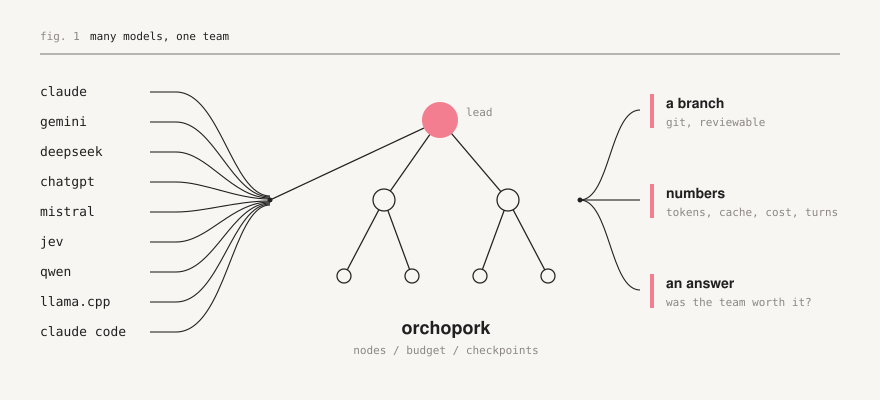
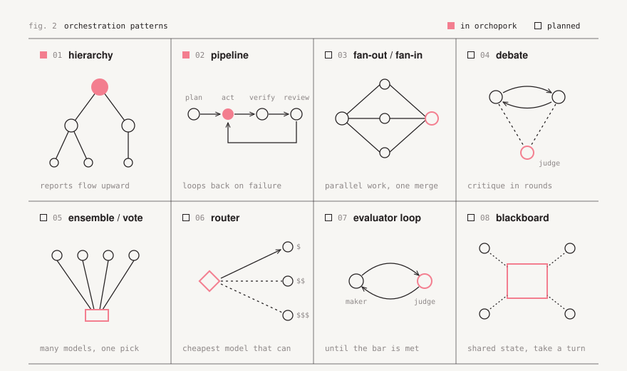
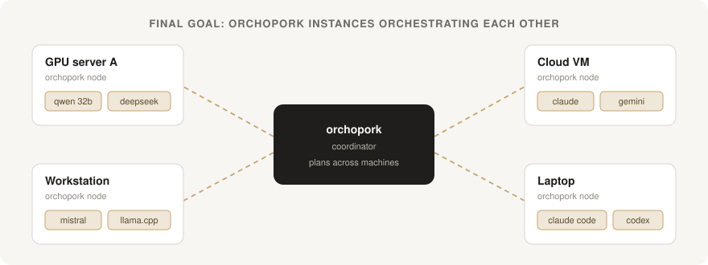

# orchopork

**A harness built for orchestrating many different LLMs as one team, and for measuring whether that team is worth it.**

orchopork lets Claude, Gemini, DeepSeek, ChatGPT, Mistral, Qwen and any other model, local or cloud, API or CLI
agent, work together on the same task. You compose the orchestration out of nodes, run it, and get detailed
metrics on what each node cost and what it contributed. It is written in Rust, ships as a single binary with an
embedded web UI, and does its work inside isolated git worktrees.

<p align="center">
  
</p>

## Why this exists

"Orchestration" is one of the most repeated words around LLMs right now. Put a planner over a few workers, add a
critic, let models debate: it sounds obviously better than one model working alone. Yet it is rarely measured.
Every extra agent re-reads context, every hand-off loses something, and a team of five can easily cost five times
as much for the same result.

orchopork has two goals:

1. **Make real pipelines efficient.** Use expensive models only where they pay off, let cheap local models do the
   bulk of the work, and cap cloud spending with a hard budget.
2. **Study orchestration itself.** Build the orchestration patterns described in the literature from nodes, run
   them on the same tasks with different models, and compare them on tokens, cost, time and outcome. The question
   is not *"can a team of agents do this?"* but *"when does a team beat a single agent, by how much, and how do we
   make that gap bigger?"*

## The idea in three layers

```text
  +------------------------------------------------------------------+
  |  Patterns     hierarchy, pipeline, fan-out, debate, vote, ...    |   what the team looks like
  +------------------------------------------------------------------+
  |  Nodes        one agent = one model + role + task + tools        |   who does the work
  +------------------------------------------------------------------+
  |  Engine       worktrees, checkpoints, budget, metrics, rewind    |   what keeps it honest
  +------------------------------------------------------------------+
```

- **Engine.** Every run gets its own branch and `git worktree`; every step is a git commit plus a SQLite row, so
  pause, crash recovery, resume and rewind are exact. Every paid call is reserved against a monthly budget before
  it is sent and recorded after.
- **Nodes.** A node is an agent: a model (any provider, or an external agent such as Claude Code), a role, a task
  and the tools it may use. Nodes do not care which vendor sits behind them; they all speak the same text
  protocol.
- **Patterns.** Nodes are wired into an orchestration. Today that is a chain-of-command tree and the classic
  plan-act-verify-review pipeline; the rest of the pattern library is on the roadmap.

## Orchestration patterns

<p align="center">
  
</p>

| Pattern           | Status    | Shape                                                                         |
|-------------------|-----------|-------------------------------------------------------------------------------|
| Hierarchy         | available | A lead commands agents, who may command agents. Work flows bottom-up.          |
| Pipeline          | available | plan, act, verify, review, with loops back on failure.                         |
| Fan-out / fan-in  | planned   | Independent workers in parallel, one node merges.                              |
| Debate            | planned   | Agents critique each other for N rounds; a judge decides.                      |
| Ensemble / vote   | planned   | The same task to several models; majority or a scorer picks.                  |
| Router            | planned   | A cheap classifier sends each task to the cheapest model that can handle it.   |
| Evaluator loop    | planned   | A maker and a judge iterate until a bar is met (reflection).                   |
| Blackboard        | planned   | Agents read and write a shared state and act when they can contribute.         |

The point of having all of them in one harness is that they can be compared on equal terms: same tasks, same
models, same accounting.

## Metrics

Every call is accounted for, per run and per agent:

- input tokens, the share of them read from the prompt cache, and output tokens;
- cost at the provider's real rates (cache reads and writes included), against the monthly cap;
- turns, escalations, failures and review rounds;
- the diff each agent produced, attached to its report.

The run header, each node on the canvas and each agent's panel show these live. The direction from here is
analysis across runs: the same goal run as a single agent and as several orchestrations, side by side, so the
cost of orchestration and what it buys are visible as numbers rather than impressions.

## Where it is going

<p align="center">
  
</p>

The final version is distributed. An orchopork running on one machine will be able to orchestrate orchopork
instances on other servers, and through them the models those servers run on their own hardware: a 32B model on
a GPU box, a few small models on a workstation, cloud APIs from a VM. A node in the graph will then be "a model on
some machine", and the coordinator will plan with each machine's resources and costs in mind.

Roadmap, roughly in order:

- [x] Single agent and hierarchical orchestra with a visual team editor
- [x] Hybrid local/cloud routing, escalation and a hard monthly budget
- [x] External agents over ACP (Claude Code, Gemini CLI, Codex)
- [x] Prompt caching and per-agent token/cost metrics
- [x] Agent contracts (owned files, acceptance criteria, verify commands) and team templates
- [ ] Pattern library: fan-out, debate, voting, router, evaluator loop, blackboard
- [ ] Free-form node graph (any pattern, not only trees)
- [ ] Benchmark mode: one goal, many orchestrations, a comparison report
- [ ] Remote orchopork nodes and cross-server orchestration

## Quick start

```sh
cargo build --release
ollama pull qwen2.5-coder:14b          # or any local model you like
cd /path/to/your/repo
/path/to/orchopork                     # opens http://localhost:7878
```

The interface is a chat box. When you send a message, orchopork asks **"Activate an agent orchestra?"**

- **No, single agent.** Pick a model (local or cloud). One agent with tools works on the request like a classic
  coding assistant. Replying continues the same conversation. This is also your baseline.
- **Yes, orchestra.** Pick a lead model. The lead drafts a team, and you review it on a canvas before anything
  runs.

### The team editor

```text
                    [ lead ]                       general      > 1000 under command
                   /        \                      major        <= 1000
            [ backend ]   [ tests ]                captain      <= 100
             /      \          \                   corporal     <= 10
      [ api ]   [ storage ]  [ e2e ]               private      none
```

- each agent is a node with an auto-assigned decimal rank, based on how many agents are under its command;
- **drag** an agent onto another to put it under that commander; any agent can command any number of agents;
- **drag from the reserve** (coder, tester, reviewer, researcher, docs writer, refactorer) onto an agent to add a
  subordinate;
- **double-click** an agent to edit its name, role, task, model and commander;
- `Ctrl+Z` undo, `Delete` remove (its subordinates move up), `A` add a subordinate, `Enter` edit; pan by dragging
  the background, zoom with the wheel.

**Approve & deploy** starts it. The same tree then shows live status (who is working, who reported, turns and cost
per agent), and clicking an agent opens its feed, where you can message that agent directly.

### How an orchestra executes

An agent acts only after all of its subordinates have reported, so work flows bottom-up. Commanders read their
subordinates' reports and can **`delegate`** work back to a direct subordinate with an order. `finish` sends a
report to the commander **with the diff of that agent's changes attached**, so commanders review diffs instead of
re-reading files. Teammates under the same commander see each other's reports as they arrive, so later agents build
on earlier work instead of re-exploring it. When the lead finishes, the optional verification command gates
completion.

Each agent's brief can also carry a contract (the lead drafts it, starting from an enabled team template when one
fits, and you can edit it on the canvas):

- **Owns**: files, `folders/` or globs (`src/**/*.rs`) that only this agent's unit may edit. An edit to a file
  another unit owns is refused with the owner's name, so agents report what must change instead of overwriting each
  other; shared files such as manifests are best left to the lead, who may edit anything.
- **Done when**: the acceptance criterion its commander reviews the report against.
- **Verify**: a command (e.g. a targeted test) that must exit 0 before the report is accepted; on failure the agent
  gets the output and tries again. The lead's verify command joins the final verification. Being model-proposed,
  verify commands run only while `allow_commands` is on.

All agents share the run's worktree and act one at a time. The whole command state is checkpointed with every
step, so pause, resume and rewind work exactly as they do for single runs.

### Token economy: a strong lead with cheaper workers

A typical setup is one Opus lead with two Sonnet workers. In the team editor, **Workers** sets the model of every
agent below the lead that has no model of its own. The engine is built so such a team spends fewer tokens than the
lead model working alone:

- **Prompt caching (Claude).** Each turn's context is split into a stable part and a volatile tail. The stable part
  (the mission, the repository as it was when the run started, the agent's role and its conversation so far) is
  sent with cache breakpoints and re-read at a fraction of the input price. What changes every turn goes after the
  last breakpoint. Commanders, who wait between turns, use the 1-hour cache.
- **A window that moves in steps.** When the conversation outgrows the context budget, old turns are dropped a
  third of the budget at a time, so the cached prefix survives many turns in a row.
- **Reports carry diffs**, and teammates see each other's reports: fewer turns spent re-reading files.

Cached tokens are billed at their real rates (reads 0.1x, or 0.05x on Opus 5.5; writes 1.25x, 2x for 1 hour); the
budget guard still reserves the uncached worst case.

### Working with many tasks

- **Sidebar** groups conversations by what needs you: *Pinned*, *Running*, *Needs you* (finished or stopped since
  you last looked), then *Today / This week / Older*. The tab title shows how many tasks are waiting.
- **`Ctrl/Cmd K`** jumps to any conversation, recent project or action.
- **Background updates.** When a task you are not looking at finishes or stops, a toast links to it; desktop
  notifications can be turned on from the sidebar.
- **Drafts are kept.** Unsent text in any composer, and a team the lead drafted, survive navigation, reloads and
  project switches.
- **Rewind from the UI.** *Rewind here* on any step, *Edit & resend* on any of your messages, *Start over* to reset
  the branch, *Retry as new* to run the same goal again with another model or another orchestration while keeping
  the original. Rewound states stay under `refs/orchopork/rewound/`.

## Models and agents

Everything goes through **Add a model** (in the model picker and on *Models & settings*). Each option is tested
before it is saved.

| Source                                   | Kind  | How                                                                     |
|------------------------------------------|-------|-------------------------------------------------------------------------|
| Ollama                                   | local | Lists installed models, downloads new ones in-app with progress.        |
| LM Studio, vLLM, llama.cpp               | local | Local OpenAI-compatible servers; free and never budget-limited.         |
| Claude, Gemini, DeepSeek                 | cloud | API key; the model list is fetched live from the provider.              |
| OpenAI, Mistral, OpenRouter, Groq, xAI, Together, ... | cloud | Any OpenAI-compatible endpoint: base URL + key, optional price per 1M tokens. Models appear as `compat:<endpoint>/<model>`. |
| Claude Code, Gemini CLI, Codex           | agent | Any [Agent Client Protocol](https://agentclientprotocol.com) agent, detected automatically. |

Models are written `provider:model`, e.g. `ollama:qwen2.5-coder:14b`. Prices live in `src/providers/pricing.rs` and
match model ids by longest prefix. Unknown models are priced high, so the budget guard over-estimates rather than
under-estimates.

Ollama's default context window is small and it silently truncates longer prompts, which breaks agent turns.
orchopork sets `num_ctx` on every request (default 16384); raise it if your hardware allows.

### External agents (ACP)

Claude Code, Gemini CLI, Codex and any other ACP agent can be used anywhere a model can: as a single agent, as the
lead of an orchestra, or as any member of one. orchopork starts the agent in the run's worktree, sends it the task
with the same context an internal agent would get, streams its actions to the UI, answers its permission requests
(shell commands only if `allow_commands` is on) and file requests (only inside the worktree), then checkpoints the
result. Each agent uses your own login for that tool, and its cost is not counted against the budget.

| Agent       | Command                                        |
|-------------|------------------------------------------------|
| Claude Code | `npx -y @agentclientprotocol/claude-agent-acp` |
| Gemini CLI  | `gemini --acp`                                 |
| Codex       | `npx -y @agentclientprotocol/codex-acp`        |

When you pick an agent, orchopork asks it what it offers over ACP (model family, version, effort) and shows those
choices. API models get the same treatment: Claude takes an effort level, Gemini takes low/medium/high. From the CLI
or config, use a query suffix: `acp:claude-code?model=opus&effort=high`, `claude:claude-opus-5-5?effort=xhigh`.

## The classic pipeline (CLI)

```text
plan ──► act ⇄ tool ──finish──► verify ──pass──► review ──approve──► done
          ▲                       │fail            │revise
          └───────────────────────┴────────────────┘
```

```sh
orchopork init --actor ollama:qwen2.5-coder:14b --planner claude:claude-sonnet-5 --critic deepseek:deepseek-chat
orchopork providers set-key claude            # reads the key from stdin
orchopork run "Add a --json flag to the list command" --verify "cargo test"
orchopork runs | show <id> | diff <id> | inject <id> "use serde" | resume <id> | rewind <id> 3 | push <id>
```

| Phase  | Who                                 | What happens                                                                                          |
|--------|-------------------------------------|-------------------------------------------------------------------------------------------------------|
| plan   | `planner` (defaults to the actor)   | One call that sees the goal, the file list and project docs, and writes a numbered plan.              |
| act    | `actor`, or `escalation` when stuck | One JSON action per turn (`read_file`, `edit_file`, `run_command`, ...). Each turn is one checkpoint. |
| verify | you                                 | The `--verify` command and every enabled validator skill must exit 0. Failures go back to the actor.  |
| review | `critic` (optional)                 | Sees goal, plan, summary, verification output and the full diff; answers `approve` or `revise`.       |

The actor is a cheap model by default. After repeated failures a turn is escalated to a stronger one; when the
budget is exhausted, cloud roles fall back to the local actor. `Ctrl-C` pauses after the current step.

**Intervening.** *Inject* adds a message the actor sees on its next turn (also on a finished run, which re-opens
it). *Rewind* resets the worktree to any step and keeps the pre-rewind tree under `refs/orchopork/rewound/`.
*Pause* stops after the step in progress.

**Safety valves** live under `limits` in `.orchopork/config.yaml` and in Settings: `steps_per_session`,
`max_failures`, `escalate_after`, `max_review_rounds`, `command_timeout_secs`, `allow_commands`, per-role context
budgets and `max_output_tokens`.

When a run is done, review the branch and merge it yourself (`git merge orchopork/<id>`), or push it from the
dashboard.

### Actor protocol

Agents reply with a short note and one JSON object:

```json
{"tool": "edit_file", "args": {"path": "src/lib.rs", "old": "fn a()", "new": "fn b()"}}
```

This is a text protocol rather than each vendor's native tool calling, so every backend behaves the same, including
local models without a tool template. That is what lets a Qwen node and a Claude node sit in the same graph. The
parser is lenient: fences or not, `name`/`arguments` aliases, and raw newlines inside JSON strings are accepted.

File tools are confined to the worktree: no absolute paths, no `..`, no symlinks pointing outside, no `.git`.
`run_command` is a real shell with a timeout that kills the whole process group; turn it off with
`limits.allow_commands: false`.

## Skills

Tone, tools, output checks and team templates are declarative files in `.orchopork/skills/` (`*.yaml`, or `*.md` with YAML front
matter whose body becomes `prompt_injection`). They hot-reload from Settings or with `orchopork skills reload`, and
conflicting skills are refused when you enable them.

```yaml
# system_modifier: layered onto every role's system prompt, ordered by priority
name: "anti-sycophancy-terse"
version: "1.0.0"
type: "system_modifier"
description: "Enforces zero conversational fluff and direct technical execution."
priority: 10
conflicts_with: []
prompt_injection: |
  Be strictly terse, technical, and utilitarian. ...
```

```yaml
# tool_definition: new tools backed by your commands. Arguments arrive as
# environment variables (ORCHOPORK_ARG_<NAME>) and are never interpolated into the command.
name: "cargo-tools"
version: "1.0.0"
type: "tool_definition"
description: "Clippy and targeted tests."
tools:
  - name: clippy
    description: "Run clippy and report warnings."
    command: "cargo clippy --all-targets 2>&1 | tail -n 80"
  - name: test_filter
    description: "Run tests whose name matches a filter."
    parameters: {filter: string}
    command: 'cargo test "$ORCHOPORK_ARG_FILTER" 2>&1 | tail -n 80'
```

```yaml
# validator: substring rules on every reply, and/or a command gating `finish`
name: "no-placeholders"
version: "1.0.0"
type: "validator"
description: "Reject placeholder code; require formatting before finishing."
validator:
  forbidden_substrings: ["todo!()", "unimplemented!()"]
  command: "cargo fmt --check"
```

```yaml
# team_template: a starting-point team the orchestra designer adapts when the
# mission fits `description`. Costs context only in the one team-design call.
name: "team-bugfix"
version: "1.0.0"
type: "team_template"
description: "Fixing a reported bug: reproduce it with a failing test, fix the cause, prove the fix."
team:
  - {id: lead, role: integrates and reviews, task: "...", done_when: "..."}
  - {id: reproducer, parent: lead, role: writes the failing test, task: "...", done_when: "..."}
  - {id: fixer, parent: lead, role: fixes the cause, task: "...", owns: ["src/"]}
```

**Who a skill is for.** Any skill can say `applies_to: [...]`; without it, it applies everywhere. Entries are
`solo` (the single-agent actor), `planner`, `critic`, `designer`, `lead`, `commander` (any orchestra agent with
subordinates), `worker` (any agent below the lead), or `role:<text>` (an orchestra agent whose id, name or role
contains the text). A leading `!` excludes: `applies_to: ["worker", "!role:doc"]` reaches every worker except the
docs writer. This keeps, say, test-first rules away from the lead and the reviewer, and saves their context. A
`validator` whose `command` should check one agent's report (e.g. a `role:test` validator running the test suite)
gates that agent's `finish`; an unscoped validator only gates the final finish, so a full test suite is not rerun at
every report.

Bundled skills: `anti-sycophancy-terse`, `test-driven-loop` (for the solo actor and workers, not the docs writer)
and the team templates `team-bugfix`, `team-feature` and `team-refactor` (enabled by default), plus
`explain-like-principal` and `markdown-memory-sync` (solo actor and lead only), which are off by default because
every enabled modifier costs context on every call.

## Files

```text
.orchopork/
  config.yaml            settings (safe to edit by hand; every key has a default)
  secrets.yaml           API keys + GitHub token, mode 0600 (plaintext at rest)
  skills/                skill files
  skills.enabled.yaml    enabled skill names
  state.db               runs, steps, spend ledger (SQLite, WAL)
  worktrees/<run-id>/    one git worktree per run
  engine.lock            one executing process per workspace
```

`.orchopork/` is added to the repository's `.git/info/exclude` automatically.

## Security model

- The server binds `127.0.0.1` only. It rejects requests whose `Host` is not local, and state-changing requests
  whose `Origin` is not local. This blocks DNS rebinding and cross-site requests; the API can run commands through
  the agent, so no web page may reach it.
- Secrets never pass through wizard state or any API response.
- Nothing is written to disk before you choose a workspace, and `git init` only happens when you ask for it.

Cross-server orchestration will need its own authenticated transport; it will not be done by opening this port.

## Development

```sh
cargo test          # unit + end-to-end engine tests (real git/SQLite, scripted LLMs)
cargo clippy --all-targets
cargo fmt
```

Requires Rust 1.89+ and `git` on `PATH`.

```text
src/
  graph/        engine, orchestra, prompts, action protocol, tools
  providers/    gateway, budget, pricing
  storage/      SQLite checkpoints and spend ledger
  skills/       loader, composition, model
  git/          worktrees and branches through hardened git calls
  server/       HTTP API and setup wizard
  acp.rs        external agents over the Agent Client Protocol
ui/index.html   the whole dashboard, dependency-free, embedded in the binary
```

## License

MIT
